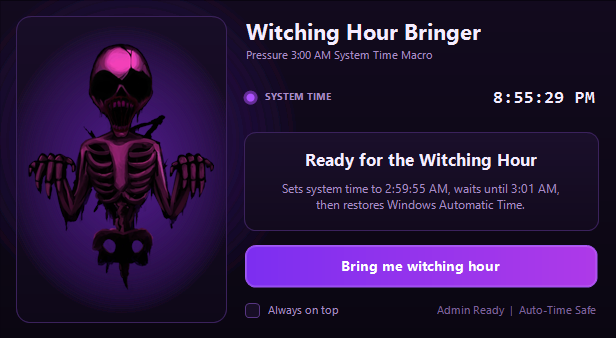
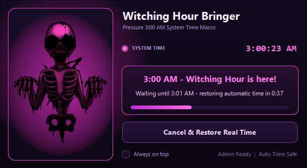

<p align="center">
  
</p>

<h1 align="center">Witching Hour Bringer</h1>

<p align="center">
  A lightweight (~272 KB), standalone Windows system-time macro for triggering the 3:00 AM <a href="https://pressure.fandom.com/wiki/Witching_Hour">Witching Hour</a> entity in Roblox <em>Pressure</em>.
</p>

<p align="center">
  
</p>

---

## How It Works

1. Click **`Bring me witching hour`**.
2. The program temporarily pauses Windows Automatic Time sync and sets your Windows system clock to **`2:59:55 AM`** sharp.
3. A 5-second countdown (`0:05 until witching hour comes`) ticks down naturally to **`3:00:00 AM`**.
4. Once **`3:00 AM`** hits, the app holds through the full minute until **`3:01:00 AM`** so the Witching Hour can arrive in-game.
5. At **`3:01:00 AM`** (or immediately if you click **`Cancel & Restore Real Time`** or close the window), your real time is restored and Windows **Set time automatically** (`W32Time` / NTP) is re-enabled and resynced.

<p align="center">
  
</p>

---

## Features

- **Ultra-lightweight standalone `.exe`** (~272 KB, native .NET Framework 4.x — no extra runtimes or installers required)
- **Exact `2:59:55 AM` jump** for a fast 5-second trigger window
- **Safe Automatic Time restoration** — pauses `W32Time` during the 3:00 AM window so Windows doesn't snap your clock back early, then restores your real time and resyncs via `w32tm /resync /force` (with an automatic direct NTP fallback)
- **1-click cancel & close protection** — cancelling or closing mid-run immediately restores your real clock
- **Optional `Always on top` toggle** for watching the timer alongside windowed/borderless gameplay

---

## Usage

1. Download or run **`Witching Hour Bringer.exe`**.
2. Approve the Administrator (UAC) prompt — required by Windows to modify the system clock and control `W32Time`.
3. Start your *Pressure* run, open the first door, and click **`Bring me witching hour`**.

---

## Building from Source

Requires Windows with the built-in .NET Framework 4.x compiler (`csc.exe`). Optionally uses Python + Pillow (`PIL`) to regenerate `WitchingHour.png` and `WitchingHour.ico` from `Images/Witchinghour.webp`.

```powershell
powershell -ExecutionPolicy Bypass -File "src\build.ps1"
```

This outputs the standalone executable to `Witching Hour Bringer.exe`.
